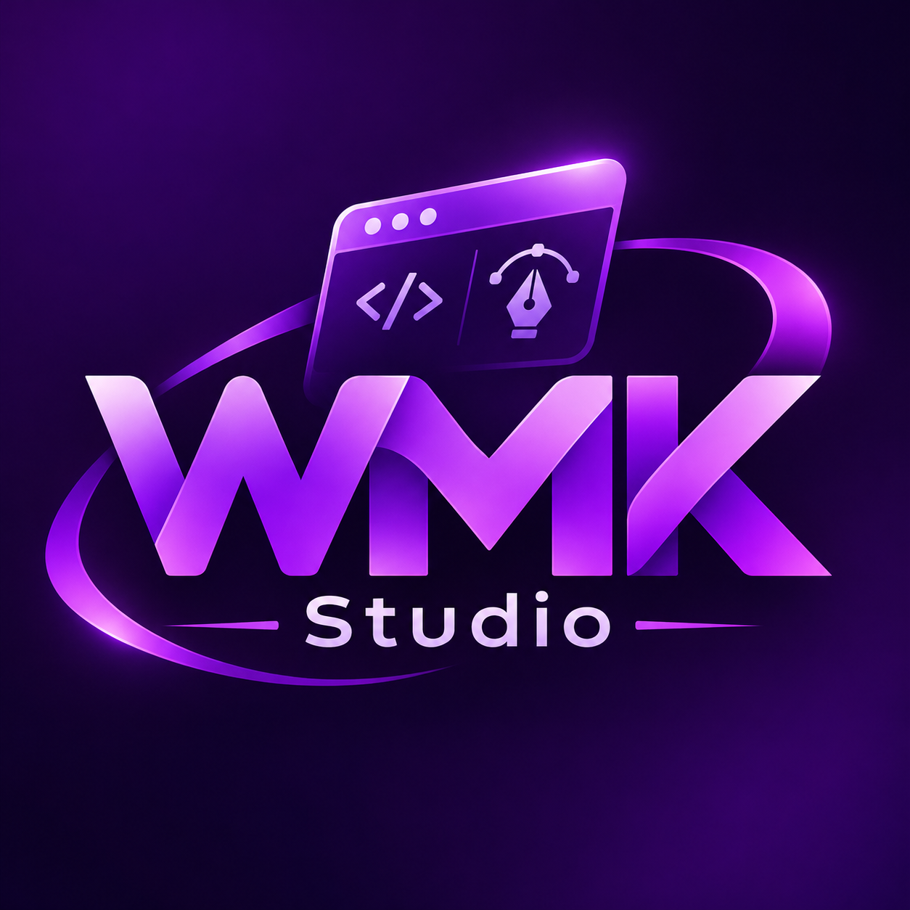

<div align="center">



# WMK Studio

**Design de interfaces, protótipos e aprendizado para criar seus próprios aplicativos.**

Fork comunitário do FigCraft com identidade **WMK** e documentação em **português brasileiro**.

[**🎓 Curso interativo**](manuais/curso-wmk-studio.html) · [**📖 Todos os manuais**](manuais/index.html) · [**📦 Releases**](https://github.com/WalneyNF/WMK-Studio/releases) · [**🗺️ Roadmap**](manuais/roadmap.html)

</div>

## Sobre o projeto

O **WMK Studio** é uma versão personalizada do [FigCraft original](https://github.com/storytold/figcraft), editor de interfaces e prototipagem escrito em Rust. O objetivo deste fork é oferecer um caminho de aprendizado em português brasileiro, documentação pública e uma identidade roxa própria, evoluindo gradualmente com testes.

**O que você pode criar:** telas de login, cadastros, dashboards, layouts para desktop, interfaces de aplicativos mobile, componentes reutilizáveis, gráficos vetoriais, bibliotecas de estilos e protótipos com navegação entre telas.

**Limitação importante:** o WMK Studio **não gera sozinho um aplicativo completo com banco de dados e regras de negócio**. Ele ajuda a desenhar, organizar e simular as interfaces. A aplicação funcional pode ser implementada depois com HTML, CSS, JavaScript, PHP, Node.js ou outras tecnologias.

Os recursos abaixo são documentados pelo projeto de origem; alguns ainda não foram verificados individualmente na versão WMK, que permanece em desenvolvimento.

| Área | Recursos documentados |
|---|---|
| Design | Frames, páginas, camadas, texto, cores, formas, ícones e vetores |
| Layout | Auto layout, alinhamentos, espaçamento, grid e restrições |
| Reuso | Componentes, instâncias, variantes, estilos e variáveis |
| Prototipagem | Navegação, transições e interações |
| Exportação | PNG, JPG, WebP, SVG e PDF |
| Avançado | Dev Mode, CLI, MCP, plugins WebAssembly, quadros e colaboração experimental |

## Baixar o WMK Studio no Windows

Acesse **[Releases do WMK Studio](https://github.com/WalneyNF/WMK-Studio/releases)**.

Quando uma Release do fork estiver disponível, baixe o arquivo **WMK-Studio.exe** ou o ZIP correspondente aos arquivos de distribuição.

1. Baixe para uma pasta de sua preferência, por exemplo `D:\Ferramentas\WMK-Studio`.
2. Extraia o ZIP, se a distribuição estiver compactada.
3. Execute `WMK-Studio.exe`.
4. Na tela inicial, escolha **Novo arquivo de design**.
5. Pressione `F` e arraste no canvas para criar seu primeiro Frame.
6. Selecione o Frame e altere seu tamanho, posição e preenchimento no painel direito.

**Atenção:** o executável compilado diretamente não é necessariamente um instalador Windows assinado. O Windows pode exibir avisos sobre a origem do aplicativo. Confira o repositório e a integridade do arquivo antes de executar; nunca desative suas proteções de segurança apenas para instalar o programa. Não confunda um binário experimental com uma distribuição homologada.

Se a página de Releases não listar arquivos, **ainda não há distribuição publicada**. Nesse caso, compile o código conforme as instruções seguintes.

## Compilar do código-fonte

### Requisitos

- Windows 10/11 de 64 bits;
- Git;
- Rustup e toolchain Rust 1.95.0 MSVC (versão adotada neste ambiente);
- Visual Studio Build Tools ou Visual Studio com compilador **MSVC C++** e **Windows SDK**;
- conexão para baixar as dependências do Cargo e espaço livre suficiente para o build.

Abra o **x64 Native Tools Command Prompt for VS** ou um terminal que tenha o MSVC configurado:

```bat
git clone https://github.com/WalneyNF/WMK-Studio.git
cd WMK-Studio
rustup toolchain install 1.95.0-x86_64-pc-windows-msvc --profile minimal
cargo +1.95.0-x86_64-pc-windows-msvc build --release -p figcraft --locked
```

O arquivo gerado pelo Cargo será:

```text
target\release\figcraft.exe
```

O nome interno `figcraft` foi mantido por compatibilidade com o workspace Rust. Para distribuir com o nome comercial:

```bat
copy /Y target\release\figcraft.exe target\release\WMK-Studio.exe
```

Existe também o script [`wmk-compilar.cmd`](wmk-compilar.cmd), que faz a compilação e a cópia com o nome WMK. **Observação:** ele usa um caminho de Visual Studio específico da máquina do mantenedor; adapte o caminho do `vcvars64.bat` no seu PC, ou execute manualmente os comandos acima.

Guia detalhado: **[Instalação, ambiente e compilação Windows](manuais/manual-compilacao-windows.html)**.

## Como colocar em português

O projeto inclui o catálogo de tradução **`crates/ui-egui/locales/pt-BR.toml`**.

Abra o programa e selecione **Preferências → Idioma → Português (Brasil)** (*Preferences → Language*). A escolha pode ser aplicada sem reiniciar. Nesta personalização, `pt-BR` foi configurado como idioma padrão para novas preferências; configurações existentes podem continuar com a opção anterior.

Para novas preferências, o tema inicial será **escuro**, alinhado à identidade roxa WMK. Se você já usa o programa, as opções antigas permanecem salvas; altere o tema manualmente em **Preferências**. Alguns textos podem permanecer em inglês por falta de tradução. Consulte o [guia de idioma e identidade](manuais/identidade-idioma-wmk.html).

## Nova identidade WMK

A marca aprovada utiliza a **logo roxa WMK Studio**, disponível no arquivo [`wmk-logo.png`](wmk-logo.png), com a paleta:

| Papel | Cor |
|---|---|
| Primária | `#8A2BE2` |
| Secundária | `#C026FF` |
| Destaque | `#E036FF` |
| Realce | `#E6B3FF` |
| Fundo | `#0B0217` |
| Superfície | `#1B0736` |
| Texto | `#F5E9FF` |
| Texto secundário | `#B79CD9` |

O projeto contém `wmk-instalar-logo.py` para derivar os ícones PNG e ICO da imagem aprovada. Se for utilizá-lo em um clone novo, instale primeiro o Pillow:

```bat
python -m pip install Pillow
python wmk-instalar-logo.py
```

**Recompile** para incorporar os ícones ao executável. A personalização é incremental: nomes técnicos de pacotes, referências internas e algumas interfaces ainda podem usar a identificação do FigCraft original.

## Arquivos de projeto: `.wmk` e `.figcraft`

A extensão nativa proposta para novos arquivos é **`.wmk`**, conservando a leitura dos arquivos antigos **`.figcraft`**. O formato binário interno permanece derivado do FigCraft para preservar compatibilidade.

**Faça backup dos projetos importantes antes de migrar.** A alteração de extensão ainda precisa ser verificada em testes completos de abrir, salvar, reabrir e recuperar documentos nesta versão WMK.

[Manual do formato `.wmk` e compatibilidade](manuais/formato-wmk.html).

## Aprenda gratuitamente — Academia WMK Studio

Criamos um **curso HTML interativo** para quem está conhecendo o editor pela primeira vez. Ele funciona localmente no navegador, sem conta ou serviço de terceiros.

**[🎓 Abrir o curso WMK Studio](manuais/curso-wmk-studio.html)**

O curso oferece **8 módulos, 24 aulas práticas, 8 questionários, barra de progresso, salvamento local e exportação/importação JSON**. Sua sequência cobre fundamentos do editor, desenho, formulários, componentes, protótipos, vetores, exportação, um sistema comercial de exemplo e recursos avançados.

O curso não instala programas nem executa ações externas: é material educacional HTML. Seu progresso é guardado no navegador, quando o armazenamento local estiver disponível.

### Central de documentação

| Material | Para quem serve |
|---|---|
| **[Central de manuais](manuais/index.html)** | Índice geral e navegação por todos os guias |
| **[Academia — Aula 1: Frames e cores](manuais/academia-aula-01-frame.html)** | Criar o primeiro cartão e entender propriedades |
| **[Manual: Design para programadores e IA](manuais/manual-design-para-programadores-e-ia.html)** | Ferramentas explicadas para quem programa e proposta de IA via Ollama/Groq |
| **[Academia — Aula 3: alinhamento e componentes](manuais/academia-aula-03-alinhamento-componentes.html)** | Organização visual, botão, grupos e componentes |
| **[Academia — Aula 2: textos e camadas](manuais/academia-aula-02-textos.html)** | Tipografia, posicionamento e botão visual |
| **[Guia dos 8 templates nativos](manuais/guia-templates-iniciais.html)** | Aprenda com modelos prontos do editor |
| **[Curso interativo completo](manuais/curso-wmk-studio.html)** | Formação prática em 8 módulos, com exercícios e avaliações |
| **[Manual completo de usuários](manuais/manual-completo-usuarios-wmk-studio.html)** | Consulta detalhada aos recursos e exercícios |
| **[Primeira aula prática](manuais/aula-pratica-figcraft.html)** | Aprender Frame, canvas, cores, texto e propriedades |
| **[Manual do usuário](manuais/manual-usuario.html)** | Primeiro contato e orientações gerais |
| **[Manual de compilação Windows](manuais/manual-compilacao-windows.html)** | Ambiente, dependências, build e diagnóstico |
| **[Idioma português e identidade WMK](manuais/identidade-idioma-wmk.html)** | Tema roxo, tradução e instalação da logo |
| **[Formato nativo .wmk](manuais/formato-wmk.html)** | Salvamento, compatibilidade e migração de arquivos |
| **[Raio X completo do código](manuais/raio-x-completo-wmk-studio.html)** | Inventário de módulos, componentes, templates, limitações e roadmap de IA |
| **[Raio X técnico](manuais/raio-x-tecnico.html)** | Visão de arquitetura, módulos e manutenção |
| **[Roadmap](manuais/roadmap.html)** | Planejamento de melhorias, testes e evolução do fork |

Para usar os manuais sem internet, **baixe o repositório completo** (Code → Download ZIP) e abra `manuais/index.html` no navegador.

## Exemplos para estudar

Na pasta [`examples/`](examples) estão documentos do projeto original:

- `ridgeline-app.figcraft` — app com telas e temas;
- `ridgeline-design-system.figcraft` — estilos, componentes e variantes;
- `ridgeline-onboarding.figcraft` — navegação e protótipos;
- `ridgeline-studio-dashboard.figcraft` — dashboard, gráficos e grid;
- `glass-and-vectors.figcraft` — curvas, formas e efeitos.

Abra **uma cópia** de cada exemplo para aprender sem alterar os originais.

## Estado do projeto

**WMK Studio está em desenvolvimento experimental.** Este fork personaliza gradualmente a marca, traduções, documentação, cor do tema e extensão do documento. A presença de código, botão ou documentação não garante que todos os recursos estejam testados no executável publicado.

Antes de cada lançamento, o objetivo é conferir compilação, abertura de interface, idioma, ícones, salvamento e recuperação de arquivos, importações, exportações e regressões relevantes. **Releases e alterações publicadas devem ser confirmadas na página do GitHub; este README não representa uma certificação do binário.**

## Contribuições e próximos passos

Queremos evoluir uma ferramenta de design acessível a quem deseja criar aplicações. São contribuições valiosas: revisão da tradução brasileira, relatórios de bugs com passos de reprodução, testes de salvar e reabrir documentos, sugestões de aulas, novos exemplos de design e melhorias de acessibilidade.

Veja o [roadmap](manuais/roadmap.html). Ao relatar um problema, informe sistema operacional, versão do aplicativo, ação realizada, resultado esperado, resultado observado e, se possível, um arquivo de exemplo **sem informações pessoais**.

## Licença, créditos e origem

O **WMK Studio** é um fork de [FigCraft](https://github.com/storytold/figcraft), criado pelo **ArtCraft Team e contribuidores**, sob licenças **MIT ou Apache-2.0**, conforme os arquivos [LICENSE-MIT](LICENSE-MIT), [LICENSE-APACHE](LICENSE-APACHE), [NOTICE](NOTICE) e [ATTRIBUTION.md](ATTRIBUTION.md).

**Personalização, documentação brasileira e identidade WMK:** Walney Moreira Klein — **walneyk@hotmail.com**.

A autoria do código original é preservada. A marca e os materiais da ArtCraft têm condições próprias, descritas na licença de marca do projeto original; as marcas do upstream não devem ser reaproveitadas indevidamente como identidade do fork.

---

<div align="center">

**WMK Studio — aprender, projetar, compartilhar e evoluir.**

**Walney Moreira Klein — walneyk@hotmail.com**

</div>
